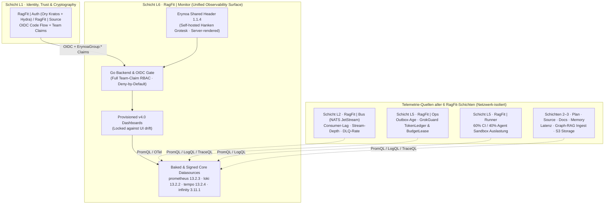

<!-- Modified by ErynoaGroup, 2026-10-15: Standardized Erynoa v4.0 README with status table, W8 lineage, quickstart, and architecture model -->
# RagFit | Monitor (`ragfit-monitor`)

| Feld | Wert |
|------|------|
| **Status** | `v0.1.3` (`MO0`–`MO7`) produktiv · v4.0 Observability-Architektur verankert |
| **Tier** | Tier 1 — Core Platform Service (`ErynoaGroup/ragfit-monitor`) |
| **Layer** | **Schicht L6 — Presentation, BFF & Observability** (Unified Observability Surface) in der 7-Schichten-Gesamtarchitektur (`L0`–`L6`) |
| **Stack / Lizenz** | Go 1.25 · TypeScript / React · Helm · Nix Flake · `AGPL-3.0-only` mit `Apache-2.0`-Verzeichnissen (siehe [`LICENSE`](LICENSE), [`LICENSING.md`](LICENSING.md), [`NOTICE.md`](NOTICE.md), [`MODIFICATIONS.md`](MODIFICATIONS.md), [`TRADEMARKS.md`](TRADEMARKS.md)) |
| **System of Record** | Provisionierte Observability-Dashboards, Alert-Visualisierungen & Korrelations-Ansichten über Metriken (Prometheus), Logs (Loki), Traces (Tempo) und `GrokGuard`-Telemetrie |
| **Container Build** | `nix build .#container` / `just image` (`pkgs.dockerTools.buildLayeredImage`, Non-Root `472:472`, Port `3000`) |

**`RagFit | Monitor`** ist die **Unified Observability Surface** in **Schicht L6** der **RagFit v4.0** Plattform für **Human + AI Collaboration**. Der Dienst stellt das zentrale Telemetrie-, Dashboard- und Korrelations-Frontend über alle 7 Plattform-Schichten (`L0`–`L6`) bereit — strikt netzwerkisoliert (OTLP/PromQL/LogQL/TraceQL/HTTPS) ohne Code-Einbettung in proprietäre Kerndienste.

> **Architektonische Einordnung (`W8`-Auflösung):**
> - **`RagFit | *` (`W8`):** Bezeichnet exklusiv die souveräne, 7-schichtige (`L0`–`L6`) Agent-First-Plattform-Dienstfamilie (`L0` NixOS-Substrat, `L1` `RagFit | Auth`, `L2` `RagFit | Bus` & `RagFit | SDK`, `L3` `RagFit | Source` & `RagFit | Plan`, `L4` `RagFit | Memory` & `atlasd`, `L5` `RagFit | Ops`, `RagFit | Agent` & `RagFit | Runner`, `L6` `RagFit | Console`, `RagFit | Docs`, `RagFit | Monitor` & `rk`).

---

## Quickstart

```bash
# 1. Reproduzierbare Nix-Entwicklungsumgebung (go, nodejs_22, yarn, just, jq, git, python3+pyyaml)
nix develop

# 2. Vollständiger lokaler Gate- & Policy-Check (Leak-Guard, Upstream-Diff, Branding, Erynoa-Header 1.1.4, Plugin-Policy)
just doctor
just ci-quick

# 3. Leichtgewichtiges Nix OCI-Container-Image bauen (dockerTools.buildLayeredImage, User 472:472, Port 3000)
just image
# oder direkt:
nix build .#container

# 4. Weiterführende Policy- & Template-Tests
./ragfit/scripts/test-helm.sh
python3 ragfit/scripts/test-role-mapping.py
./ragfit/scripts/test-check-erynoa-header.sh
```

---

<!-- ERYNOA-MODEL:BEGIN -->
## Model


<!-- ERYNOA-MODEL:END -->

---

## Systemgrenzen, Sicherheit & Lizenz-Compliance

1. **AGPLv3-Netzwerk-Isolation (§13 Source Compliance):**
   - Der vollständige korrespondierende Quellcode jedes veröffentlichten Images (`ragfit-monitor-vX.Y.Z`), einschließlich Build-Skripten, `Dockerfile`s, Nix-Flake, CI-Workflows und Patches, ist in diesem Repository unter dem jeweiligen Release-Tag veröffentlicht.
   - Herkunft, Urheberrechtshinweise und das vollständige Änderungsverzeichnis sind in [`LICENSE`](LICENSE), [`LICENSING.md`](LICENSING.md), [`NOTICE.md`](NOTICE.md) und [`MODIFICATIONS.md`](MODIFICATIONS.md) dokumentiert; Markenrechte regelt [`TRADEMARKS.md`](TRADEMARKS.md).
2. **Fail-Closed OIDC & Rollen-Mapping (`ragfit/deploy/grafana.ini`):**
   - Ausschließlicher Login über OIDC (`RagFit | Auth` / `RagFit | Source`), kein Passwort-Formular, keine Selbstregistrierung.
   - JMESPath-Rollen-Mapping prüft den vollständigen Team-Claim (`ErynoaGroup:platform-admin` $\to$ `Admin`, `ErynoaGroup:ops-editor` $\to$ `Editor`, `ErynoaGroup:ops-viewer` $\to$ `Viewer`; alle anderen werden abgewiesen).
3. **Gebackene & verifizierte Plugins (`ragfit/PLUGINS.md`):**
   - Zur Laufzeit werden keine Plugins nachgeladen. Alle erlaubten Plugins (`prometheus`, `loki`, `tempo`, `yesoreyeram-infinity-datasource`) sind nach Version und SHA-256 pro Architektur gepinnt, offline signaturgeprüft und im Image unter `/usr/share/grafana/data/plugins-bundled` (UID `472`) enthalten.
4. **Image-Signatur & Provenance:**
   - Release-Images (`ghcr.io/erynoagroup/ragfit-monitor`) werden als Multi-Arch-Index (`linux/amd64`, `linux/arm64`) mit dem Schlüssel in [`ragfit/cosign.pub`](ragfit/cosign.pub) signiert sowie mit SBOM- und SLSA-Provenance (`slsaprovenance1`) attestiert:
     ```sh
     cosign verify --key ragfit/cosign.pub --insecure-ignore-tlog=true ghcr.io/erynoagroup/ragfit-monitor@<digest>
     ```

---

## More

- **Agenten-Doktrin & Planner:** [`erynoa.md`](./erynoa.md)
- **Dokumentations-Landkarte:** [`docs/README.md`](./docs/README.md)
- **Tiefgehende Systemarchitektur (v4.0):** [`docs/ARCHITECTURE.md`](./docs/ARCHITECTURE.md)
- **Work Roadmap:** [`docs/work/ROADMAP.md`](./docs/work/ROADMAP.md)
- **Änderungsverzeichnis (AGPLv3 §5a):** [`MODIFICATIONS.md`](./MODIFICATIONS.md) · [`ragfit/modified-upstream-files.txt`](./ragfit/modified-upstream-files.txt)
- **Betriebs- & Plugin-Handbücher:** [`ragfit/PLUGINS.md`](./ragfit/PLUGINS.md) · [`ragfit/deploy/README.md`](./ragfit/deploy/README.md) · [`ragfit/docs/runbook-service-account-and-oauth.md`](./ragfit/docs/runbook-service-account-and-oauth.md) · [`ragfit/docs/runbook-cutover-mo7.md`](./ragfit/docs/runbook-cutover-mo7.md)
