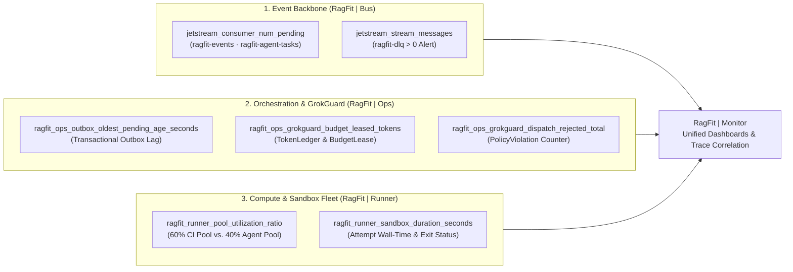

# Architektur — `RagFit | Monitor` in der RagFit v4.0 7-Schichten-Gesamtarchitektur (`L0`–`L6`)

**Stand:** 2026-10-16 · **Status:** Verbindliche Zielarchitektur v4.0 (`MO0`–`MO7` produktiv, `W8` aufgelöst)

---

## 1. Einordnung in die RagFit v4.0 7-Schichten-Gesamtarchitektur (`L0`–`L6`) & `W8`-Auflösung

Gemäß der kanonischen **`W8`-Auflösung** bezeichnet **RagFit** exklusiv die souveräne, 7-schichtige (`L0`–`L6`) **Agent-First-Plattform-Dienstfamilie (`RagFit | *`)** für **Human + AI Collaboration**. Innerhalb dieser Architektur bildet **`RagFit | Monitor`** neben **`RagFit | Console`** und **`RagFit | Docs`** die **Schicht L6 (Presentation, BFF & Observability)** als **Unified Observability Surface**:

| Schicht | Dienste & Systemeinheiten | Telemetrie- & Integrationsbezug zu `RagFit \| Monitor` |
|---------|---------------------------|--------------------------------------------------------|
| **`L6` — Presentation, BFF & Observability** | `RagFit \| Console`, `RagFit \| Docs`, **`RagFit \| Monitor`**, `rk` CLI | Nahtloser Wechsel zwischen operativem Leitstand (`Console`), Dokumentation (`Docs`) und Observability (`Monitor`) über den gemeinsamen Erynoa-Header `1.1.4` sowie kurzlebige ES256-JWT Panel-Embeds ($\le 60\,\text{s}$) |
| **`L5` — Orchestration, Multi-Agents & Execution** | `RagFit \| Ops`, `RagFit \| Agent`, `RagFit \| Runner` (`+ Runner Images`) | Visualisiert `Outbox-Age`, `GrokGuard`-Token-Budgets (`TokenLedger`, `BudgetLease`, $\mathbf{I_{10}}$) und die **60/40-Auslastung** (`ragfit-ci.slice` / `ragfit-agent.slice`, $\mathbf{I_{13}}$) von `RagFit \| Runner` |
| **`L4` — Knowledge, Memory & Ingest** | `RagFit \| Memory` (Cognee, Kùzu, LanceDB, PG), Single-Writer `atlasd` ($\mathbf{I_7}$) | Überwacht Graph-RAG-Abfragelatenzen, Vektor-Index-Größen, S3-Durchsatz und `atlasd`-Ingest-Jobs (`ragfit-knowledge-requests`) |
| **`L3` — Operative Domain Cores (Systems of Record)** | `RagFit \| Source` (Gitea MIT-Fork), `RagFit \| Plan` (OpenProject GPLv3 via `ragfit-plan-bridge`) | Überwacht API-Latenzen, Webhook-/Event-Fortschritt und Git-/PR-/Actions-Pipelines |
| **`L2` — Event, Messaging, Coordination & SDK** | `RagFit \| Bus` (NATS JetStream: 6 Streams, 4 KV-Buckets), `RagFit \| SDK` | Überwacht NATS JetStream Consumer-Lag auf allen 6 Streams, KV-Lease-Abläufe (`agent-locks`) und `ragfit-dlq` |
| **`L1` — Identity, Trust & Cryptography** | `RagFit \| Auth` (Ory Kratos + Hydra v26.2.0), 4 kryptographische Ringe | Bezieht OIDC-Identitäten & `<org>:<team>`-Claims von `RagFit \| Auth`/`Source`; überwacht Token-Exchange-Raten und Widerrufe |
| **`L0` — Declarative OS, Network & Storage Substrate** | `.nixos-devstack`, `.nixos-runnerstack` (`RunnerOS`), `.nixos-lifecyclestack`, `.nixos-common` | Überwacht Knotenmetriken, NVMe-RAID10/LUKS, GPU-/CPU-Thermik (`thermald`), k3s-Pods und Wake-on-LAN-Zyklen |

---

## 2. AGPLv3-Netzwerk-Isolation & Lizenz-Architektur

`RagFit | Monitor` steht unter `AGPL-3.0-only` (mit `Apache-2.0`-Anteilen gemäß [`LICENSING.md`](../LICENSING.md)). Um eine saubere Lizenz- und Systemgrenze zu den proprietären Kerndiensten (`RagFit | Ops`, `RagFit | Agent`, `RagFit | SDK`) zu garantieren, gelten folgende Architektur-Invarianten:

1. **Reine Netzwerkschnittstelle (Zero Code Embedding):**
   - Kein proprietärer Dienst bindet Code aus `ragfit-monitor` ein; umgekehrt enthält `ragfit-monitor` keinen proprietären Backend-Code.
   - Sämtliche Telemetriedaten fließen ausschließlich über standardisierte, offene Protokolle (OpenTelemetry OTLP, Prometheus Remote-Write / Scrape, Loki Log-Push, Tempo Trace-Ingest) an die Observability-Backends und werden von `RagFit | Monitor` per PromQL, LogQL und TraceQL abgefragt.
2. **Vollständige Quellcode-Offenlegung (AGPL-3.0 §13) & Upstream-Nachweis (§5a):**
   - Jede Änderung gegenüber Upstream `v13.2.4` (`af4a33e3786594ad72f72d97e6744010330c2977`) ist lückenlos in [`MODIFICATIONS.md`](../MODIFICATIONS.md) und [`ragfit/modified-upstream-files.txt`](../ragfit/modified-upstream-files.txt) dokumentiert und wird bei jedem CI-Lauf durch [`ragfit/scripts/verify-upstream-base.sh`](../ragfit/scripts/verify-upstream-base.sh) maschinell verifiziert.
   - `IsEnterprise = false` in `pkg/extensions/main.go` wird durch [`ragfit/scripts/verify-branding.sh`](../ragfit/scripts/verify-branding.sh) erzwungen.
3. **Gebackene, signierte & lizenzgeprüfte Plugins (`ragfit/PLUGINS.md`):**
   - Zur Laufzeit ist jegliches Nachladen externer Plugins deaktiviert.
   - Die vier erlaubten Datenquellen (`prometheus` 13.2.3, `loki` 13.2.2, `tempo` 13.2.4, `yesoreyeram-infinity-datasource` 3.11.1) werden beim Image-Build anhand ihrer SHA-256-Prüfsummen (`ragfit/plugins-allowlist.txt`) und Signatur-Fingerprints (`ragfit/scripts/verify-plugin-signature.sh`) verifiziert, nach `/usr/share/grafana/data/plugins-bundled` (UID `472`) entpackt und samt aller Go-Modul-Lizenzen unter `/licenses/plugins` ausgeliefert.

---

## 3. OIDC-Authentifizierung & Team-Claim-RBAC

Die Authentifizierung (`ragfit/deploy/grafana.ini`) ist strikt **fail-closed** konfiguriert:

- **Kein lokaler Login:** `disable_login_form = true`, `allow_sign_up = false`, `auto_assign_org = true` (Single-Org-Betrieb).
- **OIDC mit PKCE:** Anmeldung ausschließlich über `RagFit | Auth` / `RagFit | Source` (`[auth.generic_oauth]`, `use_pkce = true`).
- **Vollständiges Team-Claim-Mapping (`role_attribute_path`):**
  ```text
  contains(groups[*], 'ErynoaGroup:platform-admin') && 'Admin' ||
  contains(groups[*], 'ErynoaGroup:ops-editor') && 'Editor' ||
  contains(groups[*], 'ErynoaGroup:ops-viewer') && 'Viewer' || ''
  ```
  Mit `role_attribute_strict = true` wird jeder Nutzer ohne expliziten `ErynoaGroup:*`-Claim abgewiesen (getestet durch [`ragfit/scripts/test-role-mapping.py`](../ragfit/scripts/test-role-mapping.py)).

---

## 4. Kern-Observability-Domänen der RagFit v4.0 Plattform



### 1. `RagFit | Bus` (NATS JetStream)
- **Consumer-Lag:** Überwachung der ausstehenden Nachrichten (`num_pending`, `num_ack_pending`) auf den Streams `ragfit-events` und der Agenten-WorkQueue `ragfit-agent-tasks`.
- **Dead-Letter-Queue (`ragfit-dlq`):** Jede Nachricht in `ragfit-dlq` oder `outbox_dlq` löst sofortige Sichtbarkeit im Plattform-Dashboard aus.

### 2. `RagFit | Ops` (`GrokGuard`, `TokenLedger` & Transactional Outbox)
- **Outbox-Age:** Alter der ältesten noch nicht zugestellten Zeile in der PostgreSQL-Tabelle `outbox` (`delivered_at IS NULL`) sowie Anzahl der Retries und `outbox_dlq`-Überträge.
- **`GrokGuard` & `TokenLedger`:** Echtzeit-Visualisierung der reservierten `BudgetLease`s (`reserve_budget`), des kumulierten Token- und EUR/USD-Verbrauchs pro Agenten-Archetyp (`planner`, `code-author`, `researcher`, …), blockierter `UNKNOWN`-Läufe (kein stiller Budget-Reset) sowie abgewiesener Dispatches.

### 3. `RagFit | Runner` (60/40 Dual-Use Compute Pool)
- **60/40-Flotten-Split:** Getrennte Sättigungs-, Queue-Wartezeit- und Erfolgsraten-Panels für das **60-%-CI/CD-Kontingent** (Gitea Actions / Nix-Builds) und das **40-%-Agenten-Kontingent** (isolierte `ragfit-agent-tasks`-Sandboxes).

### 4. Cross-Domain Trace-Korrelation
- Über die durchgängige `correlation_id` der **Cross-Domain-Join-Kette** (`Plan.WorkPackage` $\leftrightarrow$ `Ops.Run` $\leftrightarrow$ `Source.PR/Commit` $\leftrightarrow$ `Runner.Job` $\leftrightarrow$ `Evidence.Bundle` $\leftrightarrow$ `Memory.Node`) lassen sich Logs in Loki und verteilte Traces in Tempo direkt einem konkreten `WorkOrder`- bzw. `Attempt`-Lauf zuordnen.

---

## 5. Gemeinsamer Erynoa-Header 1.1.4 & Nix-Container-Build

1. **Server-Side Erynoa Header (`1.1.4`):**
   - Die aus `ErynoaGroup/.assets` (`erynoa-header-v1.1.4`) unverändert übernommenen Assets unter `public/img/ragfit/erynoa/1.1.4/` (inkl. selbst-gehosteter Schrift *Hanken Grotesk*) werden in `pkg/api/index.go` und `public/views/index.html` serverseitig gerendert (`current = monitor`, Theme-Synchronisation, Skip-Link, Basis-Domain-Ableitung aus `root_url` ohne externe CDNs).
2. **Leichtgewichtiger Nix-Container-Build (`flake.nix`):**
   - `nix build .#container` (`just image`) erzeugt über `pkgs.dockerTools.buildLayeredImage` ein reproduzierbares OCI-Image mit `pkgs.grafana`, `pkgs.cacert`, `pkgs.tzdata`, `ragfit/deploy/grafana.ini`, `conf/provisioning/`, `public/img/ragfit/` und `/licenses/` unter dem Non-Root-User `472:472` auf Port `3000`.
